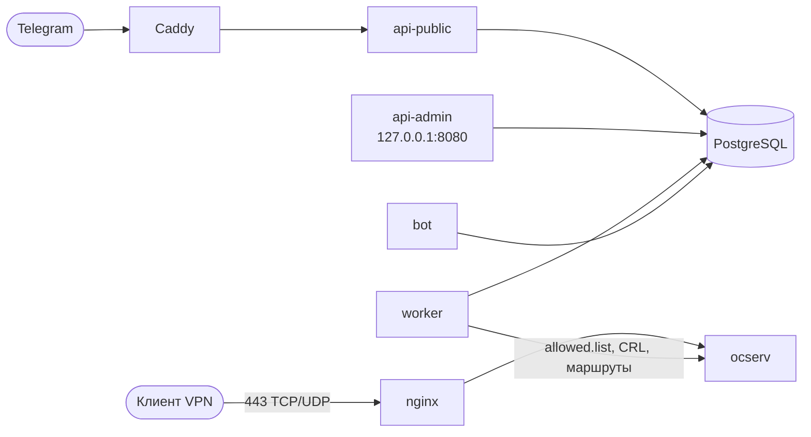

<p align="center">
  <picture>
    <source media="(prefers-color-scheme: dark)" srcset="assets/logo-dark.svg">
    
  </picture>
</p>

<p align="center">
  <b>Свой VPN-сервис за одну команду</b><br>
  Telegram Mini App, подписки, ключи и админка поверх ocserv (OpenConnect / AnyConnect)
</p>

<p align="center">
  <a href="https://github.com/sontiago/ocmanager/actions/workflows/backend.yml"></a>
  <a href="https://github.com/sontiago/ocmanager/actions/workflows/admin.yml"></a>
  <a href="https://github.com/sontiago/ocmanager/actions/workflows/tma.yml"></a>
  <a href="https://github.com/sontiago/ocmanager/actions/workflows/installer.yml"></a>
  <br>
  
  
  
  
  
  
  
</p>

## Возможности

- **Mini App в Telegram:** тарифы, оплата (Tribute), выдача ключей устройствам, промокоды и рефералы.
- **Админка:** клиенты, подписки, платежи, статистика, квоты трафика, алерты о злоупотреблении, управление нодой.
- **Сертификатная авторизация:** собственный CA, CRL, один ключ — одно устройство.
- **Маршруты мимо VPN:** адреса, которые клиенты открывают напрямую, настраиваются в админке.
- **Установка мастером:** `./install.sh` задаёт вопросы и поднимает всё, включая сертификаты Let's Encrypt.
- **Обслуживание одной командой:** `ocm` — статус, бэкап и восстановление (по желанию), обновление и откат.

## Быстрый старт

Нужны: сервер Debian 12+ или Ubuntu 22.04+, два домена с A-записью на его IP, открытые порты 80/tcp, 443/tcp и 443/udp, токен бота из [@BotFather](https://t.me/BotFather).

```bash
git clone https://github.com/sontiago/ocmanager.git && cd ocmanager
sudo ./install.sh
```

Дальше мастер всё спросит сам. Подробности и что делать после установки: **[deploy/INSTALL.md](deploy/INSTALL.md)**.

## Команда `ocm`

| Команда | Что делает |
|---|---|
| `ocm status` | проверка состояния всех компонентов |
| `ocm logs [сервис] [-f]` | журналы |
| `ocm update` / `ocm rollback` | обновление и возврат на прежнюю версию |
| `ocm backup-enable` / `ocm backup` / `ocm restore` | зашифрованные резервные копии |
| `ocm admin-chat <id>` / `ocm admin-password <логин>` | алерты в Telegram и пароль админа |

## Как это устроено



Один сервер, один набор сервисов в Docker Compose. Мультитенантности нет: каждая установка независима.
Админка доступна только через SSH-туннель.

## Разработка

```bash
cd backend && make dev-up && make check     # Postgres + Redis, линтер, mypy, тесты
cd frontend/admin && npm ci && npm test     # админка (то же для frontend/tma)
```

## Структура

| Каталог | Что внутри |
|---|---|
| `backend/` | FastAPI, бот, воркер, CLI, миграции |
| `frontend/tma/` | Telegram Mini App (React) |
| `frontend/admin/` | веб-админка (React) |
| `ocserv/` | образ ноды ocserv |
| `deploy/` | Docker Compose, установщик, `ocm`, [инструкция](deploy/INSTALL.md), [техсправка](deploy/README.md) |
| `scripts/` | `doctor.sh` и проверки конфигов |
