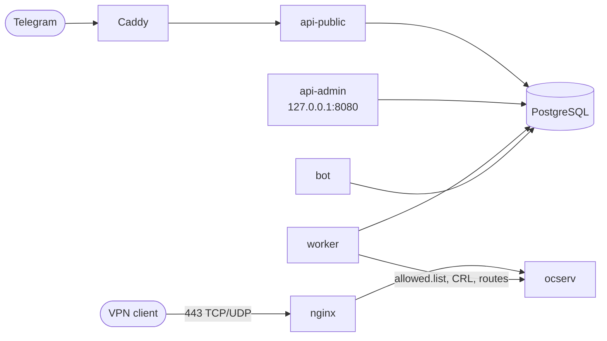

<p align="center">
  <picture>
    <source media="(prefers-color-scheme: dark)" srcset="assets/logo-dark.svg">
    
  </picture>
</p>

<p align="center"><b>English</b> · <a href="README.ru.md">Русский</a></p>

<p align="center">
  <b>Your own VPN service in one command</b><br>
  Telegram Mini App, subscriptions, keys and an admin panel on top of ocserv (OpenConnect / AnyConnect)
</p>

<p align="center">
  <a href="https://github.com/sontiago/ocmanager/actions/workflows/backend.yml"></a>
  <a href="https://github.com/sontiago/ocmanager/actions/workflows/admin.yml"></a>
  <a href="https://github.com/sontiago/ocmanager/actions/workflows/tma.yml"></a>
  <a href="https://github.com/sontiago/ocmanager/actions/workflows/installer.yml"></a>
  <br>
  
  
  
  
  
  
  
</p>

## Features

- **Telegram Mini App:** plans, payments (Tribute), device keys, promo codes and referrals.
- **Admin panel:** clients, subscriptions, payments, statistics, traffic quotas, abuse alerts, node management.
- **Certificate authentication:** its own CA and CRL, one key per device.
- **Routes that bypass the VPN:** addresses clients open directly are configured in the admin panel.
- **Wizard installation:** `./install.sh` asks the questions and sets everything up, including Let's Encrypt certificates.
- **One-command maintenance:** `ocm` for status, backup and restore (optional), update and rollback.

## Quick start

You need: a Debian 12+ or Ubuntu 22.04+ server, two domains with A records pointing to its IP, open ports 80/tcp, 443/tcp and 443/udp, and a bot token from [@BotFather](https://t.me/BotFather).

```bash
git clone https://github.com/sontiago/ocmanager.git && cd ocmanager
sudo ./install.sh
```

The wizard asks everything it needs (English by default; add `--lang ru` for Russian, the choice is remembered for `ocm`). Details and what to do after the installation: **[deploy/INSTALL.md](deploy/INSTALL.md)**.

## The `ocm` command

| Command | What it does |
|---|---|
| `ocm status` | health check of all components |
| `ocm logs [service] [-f]` | logs |
| `ocm update` / `ocm rollback` | update and return to the previous version |
| `ocm backup-enable` / `ocm backup` / `ocm restore` | encrypted backups |
| `ocm admin-chat <id>` / `ocm admin-password <login>` | Telegram alerts and the admin password |

## How it works



One server, one set of services in Docker Compose. There is no multi-tenancy: every installation is independent.
The admin panel is reachable only through an SSH tunnel.

## Development

```bash
cd backend && make dev-up && make check     # Postgres + Redis, linter, mypy, tests
cd frontend/admin && npm ci && npm test     # admin panel (same for frontend/tma)
```

## Layout

| Directory | Contents |
|---|---|
| `backend/` | FastAPI, bot, worker, CLI, migrations |
| `frontend/tma/` | Telegram Mini App (React) |
| `frontend/admin/` | web admin panel (React) |
| `ocserv/` | ocserv node image |
| `deploy/` | Docker Compose, installer, `ocm`, [guide](deploy/INSTALL.md), [technical reference](deploy/README.md) |
| `scripts/` | `doctor.sh` and config checks |

Documentation (architecture, data flows, per-project details) is in [docs/](docs/README.md) and is written in Russian.
