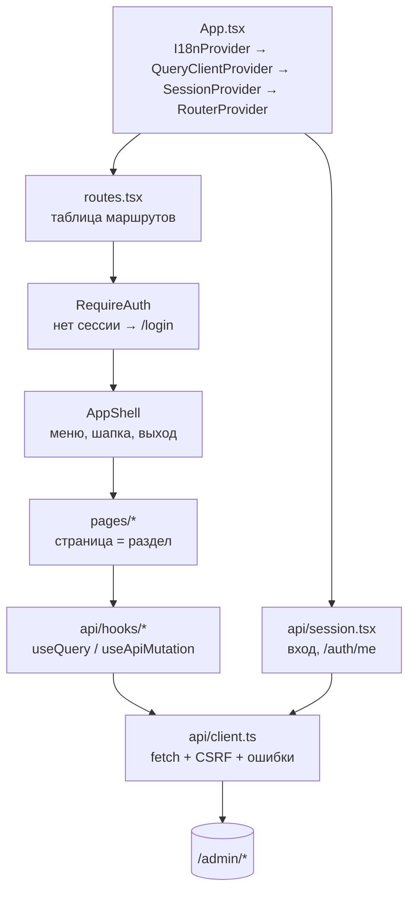

# Веб-админка: архитектура

SPA для владельца: клиенты, подписки, платежи, статистика, нода, настройки. Запуск и проверки: [frontend/admin/README.md](../../frontend/admin/README.md).

## Стек

| Область | Что |
|---|---|
| Язык, UI | TypeScript 6, React 19, Tailwind CSS 4 (визуально AdminLTE), иконки в `ui/Icon.tsx` |
| Сборка | Vite 8; результат встраивается в образ backend отдельной стадией и отдаётся `api-admin` на `/` |
| Роутинг | React Router 7 (`createBrowserRouter`) |
| Данные | TanStack Query 5 и собственный `ApiClient` на `fetch` |
| Графики | Recharts (`ui/charts.tsx`) |
| Типы API | `src/api/generated.d.ts` из OpenAPI бэкенда |
| Тесты | Vitest + Testing Library + jsdom; линтер oxlint |

## Как устроено

### Слой данных

- **`api/client.ts`**: `get/post/patch/delete` с префиксом `/admin`, заголовок `X-CSRF-Token` на всех изменяющих запросах,
  разбор конверта ошибок `{error:{code,message}}` в `ApiError`, `401` → колбэк «сессия кончилась» (выход на `/login`).
- **`api/session.tsx`**: `SessionProvider` хранит админа и CSRF-токен, выполняет вход/выход, перечитывает `/auth/me`
  (например, после включения TOTP). Статусы: `loading`, `anon`, `authed`.
- **`api/hooks/*.ts`**: по файлу на раздел (`clients.ts`, `plans.ts` …). Запросы — `useQuery` с ключами из `queryKeys.ts`.
  Изменения — `useApiMutation(run, invalidate)`: после успеха инвалидирует перечисленные ключи, интерфейс обновляется сам.
- **Типы**: `api/types.ts` экспортирует `S<"Имя">` — короткий доступ к схемам из `generated.d.ts`. Поменялся ответ бэкенда: после
  `npm run api:types:offline` компилятор покажет, что сломалось.

### Страницы

| Маршрут | Страница | Что показывает и делает |
|---|---|---|
| `/` | Overview | сводка: клиенты, доход, трафик, состояние ноды, проблемные вебхуки |
| `/clients`, `/clients/:id` | Clients, ClientDetail | поиск и фильтры; карточка клиента: подписка, устройства, платежи; блокировка, выдача тарифа, продление, сброс трафика, выпуск ключа |
| `/stats` | Stats | графики трафика, выручки, клиентов и экономики |
| `/subscriptions` | Subscriptions | все подписки, отмена автопродления, досрочное истечение |
| `/plans` | Plans | тарифы: создание и редактирование (`PlanForm`) |
| `/promo`, `/referrals` | Promo, Referrals | промокоды и их погашения; реферальная статистика и награды |
| `/payments` | Payments | платежи и вебхуки (`PaymentsTab`, `WebhooksTab`), переобработка |
| `/devices` | Devices | все ключи, отзыв, сессии устройства |
| `/node` | Node | здоровье, сессии, действия (старт/стоп/перезапуск), сверка, журнал в реальном времени (SSE) |
| `/audit` | Audit | журнал действий, фильтры |
| `/settings` | Settings, BypassRoutes | runtime-настройки; конструктор «Маршруты мимо VPN» |
| `/profile` | Profile | пароль, TOTP, активные сессии |
| `/login` | Login | вход с кодом TOTP |

### Общие компоненты (`src/ui`)

`AppShell` (меню и каркас), `DataTable`, `Pagination`, `Card`/`SmallBox`, `Modal`/`ConfirmDialog` (с фокус-ловушкой),
`Field` (поля и стили), `Notice`, `StatusBadge`, `ExportButton` (скачивание CSV через `/admin/export`), `charts`.

### Утилиты (`src/lib`)

- `useUrlFilters`: фильтры списков хранятся в URL (`?q=…&offset=…`), любое изменение фильтра сбрасывает страницу;
- `useEventSource`: поток SSE для журнала ноды (при обрыве закрывается, а не переподключается, чтобы не задваивать строки);
- `settingsForm`, `planForm`: преобразование формы в запрос и обратно (ГБ ↔ байты, списки через запятую);
- `routes.ts`: проверка адресов для «Маршруты мимо VPN» (зеркало серверной валидации, итог проверяет сервер);
- `format`, `dates`, `errors` (перевод кодов ошибок в тексты).

## Безопасность

- Сессия — httpOnly cookie, CSRF-токен передаётся заголовком (хранится в памяти, не в `localStorage`).
- Тот же origin, что и API: CORS не нужен.
- Админка слушает только loopback; доступ по SSH-туннелю. Пароль и TOTP проверяет бэкенд.
- Данные из API выводятся через React (экранируются); HTML из ответов не вставляется.

## i18n

Словари `i18n/ru.json` и `en.json`, плоские ключи (`settings.trialDays`); тест следит за совпадением наборов ключей. Язык
переключается кнопкой в шапке и запоминается в браузере.

## Тесты

Рядом с файлами (`*.test.tsx`). `test/utils.tsx` поднимает страницу с подменой сетевых запросов
(`handlers: { "GET /admin/…": … }`) и роутером; есть `FakeEventSource` для потока логов. Типичный тест: открыть страницу, выполнить
действие пользователя, проверить отправленный запрос и результат на экране.
