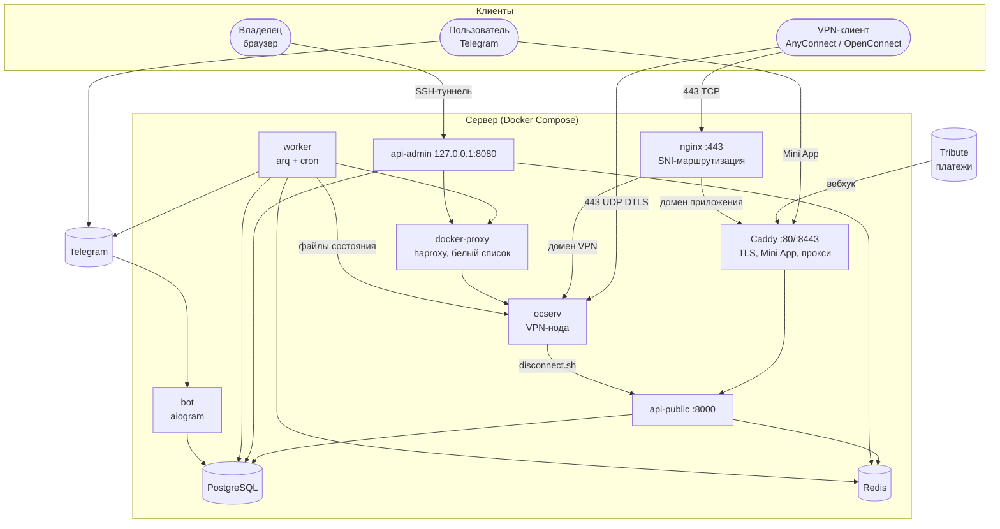

# Общая архитектура

ocmanager превращает сервер с ocserv в продаваемый VPN-сервис: клиент покупает подписку в Telegram Mini App,
ключ выдаётся автоматически, продление не требует действий администратора, а владелец управляет всем из веб-админки.
Каждая установка полностью независима (мультитенантности нет): один сервер, один набор сервисов, два домена.

## Компоненты



| Компонент | Роль |
|---|---|
| **ocserv** | VPN-шлюз. Пускает только по клиентскому сертификату нашего CA и только логины из `allowed.list`. |
| **api-public** | API Mini App (`/api/tma/*`), приём вебхуков платёжной системы, внутренний хук от ноды. |
| **api-admin** | API веб-админки (`/admin/*`) и её статика. Слушает только loopback. |
| **worker** | Очередь и cron: доставка событий, уведомления, сверка ноды, сбор трафика, истечение подписок, CRL. |
| **bot** | Telegram-бот: `/start`, реферальные ссылки, `/whoami`. Сообщения не рассылает. |
| **Caddy** | Сертификаты Let's Encrypt для обоих доменов, статика Mini App, прокси на API. |
| **nginx** | Принимает 443/tcp и по SNI направляет VPN-домен в ocserv, а остальное в Caddy. |
| **docker-proxy** | haproxy с белым списком: единственный путь воркера и админки к Docker API (только `ocm-ocserv`). |
| **PostgreSQL / Redis** | Источник истины / очередь, rate limit, одноразовые ссылки. |

## Принципы

1. **Postgres — источник истины.** Состояние ноды (`allowed.list`, CRL, маршруты) выводится из БД и пересобирается
   целиком. Раз в 5 минут `reconcile` сверяет ноду с БД и чинит расхождения; потерянное событие не ломает доступ.
2. **Доступ на ноде = устройства клиентов с живой подпиской.** Любое изменение подписки, блокировки или устройства
   порождает событие, обработчик пересчитывает список (идемпотентно).
3. **События доставляются at-least-once** через транзакционный outbox; обработчики идемпотентны.
4. **VPN не зависит от панели.** `connect.sh` читает только локальный файл: при лежащем API подключения продолжают работать.
5. **Секреты не лежат на диске в открытом виде.** `.p12` живёт в Redis зашифрованным 15 минут и скачивается один раз.
   Приватный ключ CA есть только у панели, а у ноды (контейнера ocserv) только публичный `ca.crt`.
6. **Доменные модули не знают друг друга.** Склейка только в `flows/` (проверяется в CI).

## Границы доверия

| Граница | Как защищена |
|---|---|
| Интернет → Mini App API | подпись `initData` Telegram (HMAC), rate limit по клиенту |
| Интернет → вебхук | подпись провайдера, сырое тело сохраняется до обработки, идемпотентность по id события |
| Интернет → `/internal` | закрыт в Caddy (404); доступен только ноде по внутренней сети `hooks` и токену |
| Владелец → админка | только SSH-туннель, пароль + TOTP, серверная сессия, CSRF, rate limit входа |
| Воркер → Docker | через `docker-proxy`, разрешён `exec/start/stop/restart/logs/inspect` только для `ocm-ocserv` |
| VPN-клиент → ocserv | сертификат нашего CA, CRL, `allowed.list`, PROXY-протокол (адрес клиента не теряется) |

## Технологический стек

| Часть | Стек | Подробнее |
|---|---|---|
| Бэкенд | Python 3.12, FastAPI, SQLAlchemy 2, Alembic, arq, aiogram 3 | [backend/architecture.md](backend/architecture.md) |
| Админка | React 19, TypeScript, Vite, Tailwind, TanStack Query | [admin/architecture.md](admin/architecture.md) |
| Mini App | React 19, TypeScript, Vite, Telegram SDK, TanStack Query | [tma/architecture.md](tma/architecture.md) |
| Нода | ocserv 1.3, Debian, tini | [deploy.md](deploy.md) |
| Инфраструктура | Docker Compose, Caddy 2, nginx, haproxy, PostgreSQL 16, Redis 7 | [deploy.md](deploy.md) |
| Установка | Python 3 (stdlib) мастер `install.sh`, `ocm`, systemd-таймер | [deploy.md](deploy.md) |

## Структура репозитория

```
backend/            Python-пакет ocmanager (API, воркер, бот, CLI, миграции)
frontend/tma/       Telegram Mini App
frontend/admin/     веб-админка
ocserv/             образ VPN-ноды (шаблон конфига, хуки, entrypoint)
deploy/             docker-compose, Caddy, nginx, haproxy, установщик, ocm, инструкция
scripts/            doctor.sh и проверки конфигов
assets/             логотип
docs/               эта документация
install.sh          вход в установку
```
