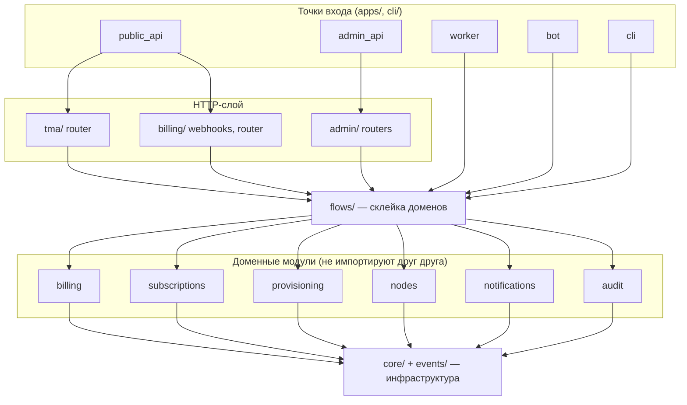

# Бэкенд: архитектура

Один пакет `ocmanager` (`backend/src/ocmanager`), четыре процесса из него и CLI. Стек и запуск: [backend/README.md](../../backend/README.md).

## Слои и модули

| Слой | Каталоги | Правило |
|---|---|---|
| Инфраструктура | `core/`, `events/` | импортируют только друг друга |
| Домены | `billing`, `subscriptions`, `provisioning`, `nodes`, `notifications`, `audit` | импортируют **только себя**, `core` и `events` |
| Склейка | `flows/`, `tma/`, `admin/`, `apps/`, `cli/` | можно всё |

Правило проверяет `scripts/check_boundaries.py` (`make boundaries`, входит в `make check` и CI). Пример: покупка затрагивает
billing, subscriptions и audit, поэтому код живёт в `flows/purchase.py`, а в `billing/` нет ни одного импорта `subscriptions`.
Зависимость domain → domain недопустима; общие данные передаются параметрами или событиями.

## Домены

| Модуль | Отвечает за |
|---|---|
| `billing` | тарифы (`Plan`), платежи, намерения оплаты, вебхуки провайдера, промокоды; адаптер Tribute (`providers/`) |
| `subscriptions` | клиент, подписка и её автомат состояний (`state.py`, чистые функции), рефералы и уровни (`referral.py`), награды |
| `provisioning` | устройства, PKI (`pki/`: CA, сертификаты, `.p12`, CRL), отзывы, одноразовая выдача `.p12` (`delivery.py`) |
| `nodes` | нода, драйвер (`driver/`), клиент `occtl` и его парсер, сессии, замеры трафика, файлы состояния (`files.py`) |
| `notifications` | очередь исходящих сообщений, шаблоны ru/en, доставка в Telegram |
| `audit` | журнал действий (`audit_log`) |
| `core` | настройки процесса (`config.py`, env `OCM_`), БД, ошибки, часы, crypto, rate limit, runtime-настройки (`settings_store.py`) |
| `events` | типы доменных событий и транзакционный outbox (`bus.py`) |

## `flows/` — склейка

Каждая функция: открытая транзакция (сессия передаётся снаружи, `commit` делает вызывающий), вызов доменных сервисов,
запись аудита, при необходимости `bus.record(event)`.

| Файл | Что склеивает |
|---|---|
| `purchase.py` | вебхук → клиент, платёж, подписка, события |
| `checkout.py` | выбор тарифа → намерение → ссылка на оплату |
| `trial.py`, `grants.py`, `subscriptions.py` | пробный период, ручная выдача, продление/отмена с аудитом |
| `devices.py`, `revocations.py` | выпуск и отзыв ключей, пересборка CRL |
| `access.py` | `allowed.list` из БД, сброс лишних сессий |
| `traffic.py`, `abuse.py` | опрос нод и перенос расхода в подписки; алерты о злоупотреблении |
| `reconcile.py` | сверка ноды с БД |
| `referrals.py`, `promo.py` | рефералы, уровни, промокоды |
| `notify.py`, `handlers.py` | подписка уведомлений и побочных действий на события |
| `clients.py`, `plans.py`, `nodes.py` | регистрация клиента, тарифы, здоровье ноды — всё с аудитом |
| `deps.py` | FastAPI-зависимости, общие для обоих API |

## Соглашения

- **Время:** только через `core/clock.py` (`utcnow`), в функции передаётся параметром: чистые правила не читают часы.
- **Деньги:** целые в минимальных единицах валюты (`price_amount`).
- **Ошибки:** `DomainError` с кодом и HTTP-статусом (`core/errors.py`); ответ всегда `{"error": {"code", "message"}}`.
  Коды: `unauthorized`, `initdata_expired`, `forbidden`, `not_found`, `conflict`, `invalid_transition`, `device_limit_reached`,
  `trial_already_used`, `subscription_inactive`, `not_applicable`, `promo_invalid`, `promo_already_used`, `validation_error`,
  `rate_limited`, `node_unavailable`.
- **Транзакции:** событие и сообщение пишутся в одной транзакции с изменением (outbox). Обработчики событий не делают
  `commit` и обязаны быть идемпотентными.
- **Блокировки:** строки клиента/пригласившего блокируются `FOR UPDATE` в фиксированном порядке (иначе взаимные блокировки
  при оплатах и наградах).
- **Логи:** structlog, JSON в проде. Секреты (`SecretStr`) не попадают в вывод.
- **Миграции:** Alembic, нумерованные `0001…0014`; тест проверяет, что модели и миграции совпадают.
- **Типы:** `mypy --strict`; `ruff` с правилами безопасности (`S`), `DTZ` (запрет naive-времени), `ASYNC`.
- **Тесты:** рядом с кодом (`test_*.py`), Postgres и Redis из `make dev-up`; интеграционные сценарии с живым ocserv — `tests/integration`.

## Настройки

Два уровня:

1. **Процесс** (`core/config.py`, переменные `OCM_*` из `.env`): БД, Redis, ключ приложения, токены, домены, пути PKI и состояния.
   Меняются перезапуском.
2. **Runtime** (`core/settings_store.py`, таблица `settings`): пробный период, язык по умолчанию, ссылка поддержки, чаты админов,
   напоминания, хранение трафика, пороги алертов, маршруты мимо VPN (`bypass_routes`). Меняются из админки без перезапуска,
   значения проверяются целиком; плохое значение в БД откатывается к умолчанию.
