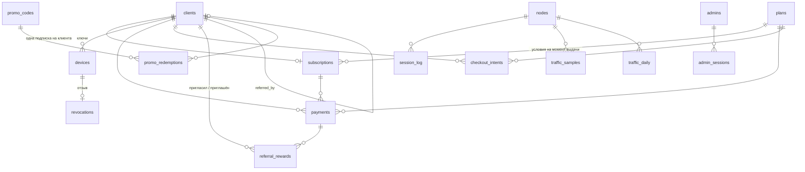

# Модель данных

PostgreSQL 16, схема ведётся миграциями Alembic (`backend/alembic/versions/0001…0014`). Все таблицы собираются в
`ocmanager.models` (импорт регистрирует их для внешних ключей между доменами).

## Связи

Без внешних ключей (связь по значению): `session_log.username` ↔ `devices.ocserv_username`, `webhook_events` ↔ `payments`
по `external_id`, `audit_log.target_*`, `event_outbox`, `outbox_messages`, `settings`.

## Таблицы по доменам

### subscriptions

| Таблица | Назначение и важные поля |
|---|---|
| `clients` | Telegram-клиент: `telegram_id` (уникален), `lang` (ru/en), `trial_used_at`, `is_blocked`, `referral_code`, `referred_by`, бонусы `bonus_devices`, `bonus_traffic_bytes` |
| `subscriptions` | **одна на клиента** (`client_id` уникален): `status`, `plan_id`, `plan_is_trial`, `started_at`, `expires_at`, `auto_renew`, `device_limit`, `traffic_limit_bytes`, `traffic_used_bytes`, `traffic_period_start`, `provider`, `external_subscription_id` |
| `referral_rewards` | награды: `kind` (base/tier), `tier` (3/5/10), `days`, `invitee_days`, `devices`, `traffic_bytes`, `status` (applied/pending/capped) |

### billing

| Таблица | Назначение и важные поля |
|---|---|
| `plans` | тариф: `code` (уникален), `name_i18n`, `description_i18n`, `duration_days`, `device_limit`, `traffic_limit_bytes` (NULL — безлимит), `speed_limit_kbps`, `price_amount`, `currency`, `provider_product_ids` (JSONB), `is_active`, `is_trial`, `sort_order` |
| `payments` | факт оплаты: `provider`, `external_id` (уникальна пара), `amount`, `currency`, `status` (succeeded / refunded), `raw_payload` |
| `webhook_events` | входящие вебхуки: `external_event_id`, `signature_ok`, `payload` (JSONB), `raw_body`, `status` (received → processed / ignored / failed / dead / rejected), `attempts`, `last_error` |
| `checkout_intents` | «клиент нажал купить тариф»: сопоставляет оплату с клиентом |
| `promo_codes` | `code`, `kind` (days/traffic), `value`, `max_uses`, `uses`, `expires_at`, `is_active` |
| `promo_redemptions` | погашения; уникальна пара (код, клиент) |

### provisioning

| Таблица | Назначение и важные поля |
|---|---|
| `devices` | ключ устройства: `client_id`, `seq` (номер у клиента, не переиспользуется), `name`, `platform`, `ocserv_username` (`c{client}-d{seq}`, уникален), `cert_serial`, `cert_fingerprint`, `issued_at`, `cert_expires_at`, `revoked_at`, `revocation_reason`, `last_seen_at` |
| `revocations` | очередь отзывов для CRL: `device_id` (уникален), `cert_serial`, `revoked_at`, `applied_at` |

### nodes

| Таблица | Назначение и важные поля |
|---|---|
| `nodes` | нода: `driver` (`local_docker`), `config` (JSONB), `public_host`, `status` (unknown/online/degraded/offline), `last_seen_at`, `is_active`, `last_reconcile_at`, `last_reconcile_report` (JSONB) |
| `session_log` | сессии VPN: `username`, `ocserv_session_id`, `started_at`, `ended_at`, `client_ip`, `vpn_ip`, `bytes_in/out`, `last_polled_at`, `final_received` |
| `traffic_samples` | сырые дельты между опросами; чистятся по сроку хранения (`traffic_retention_days`) |
| `traffic_daily` | дневные итоги по (`username`, `node_id`, `day`); остаются надолго, на них строятся графики |

### notifications, events, audit, admin, core

| Таблица | Назначение и важные поля |
|---|---|
| `event_outbox` | доменные события: `name`, `payload`, `available_at`, `attempts`, `last_error`, `dispatched_at` (максимум 10 попыток) |
| `outbox_messages` | сообщения в Telegram: `recipient_type`, `chat_id`, `template_key`, `lang`, `payload`, `dedupe_key` (антидубль), `status`, `attempts`, `send_after`, `sent_at` |
| `audit_log` | кто (`actor_type`/`actor_id`/`ip`), что (`action`), над чем (`target_*`), подробности (`details` JSONB) |
| `admins` | администратор: `username`, `password_hash` (bcrypt), `role` (сейчас только `owner`), `totp_secret`, `totp_enabled`, `is_active` |
| `admin_sessions` | серверные сессии: `token_hash`, `csrf_token`, `expires_at`, `ip`, `user_agent` |
| `settings` | runtime-настройки: `key`, `value` (JSONB) |

## Автомат состояний подписки

Чистые функции в `subscriptions/state.py`: принимают состояние, возвращают новое; запрещённый переход — `InvalidTransition`.

```mermaid
stateDiagram-v2
    [*] --> trial: start_trial (подписки ещё нет)
    [*] --> active: activate / renew (оплата или выдача)
    trial --> active: activate / renew (остаток trial сгорает)
    expired --> active: activate / renew
    exhausted --> active: activate / renew
    active --> active: renew (дни к концу срока)
    active --> cancelled: cancel_auto_renew
    cancelled --> active: renew
    trial --> expired: expire (срок вышел)
    active --> expired: expire
    cancelled --> expired: expire
    exhausted --> expired: expire
    trial --> exhausted: exhaust (квота выбрана)
    active --> exhausted: exhaust
    cancelled --> exhausted: exhaust
    exhausted --> active: reset_traffic / grant_traffic
    expired --> cancelled: extend (дни вручную; у trial — в trial)
    active --> blocked: block
    trial --> blocked: block
    blocked --> active: unblock (или trial, cancelled, expired по сроку)
```

Покупка и ручная выдача тарифа идут через `activate`/`renew`; `extend` — ручное добавление дней из админки; `exhaust`,
`reset_traffic`, `grant_traffic` — квоты; `expire_now` — немедленное истечение из админки. Статус `pending_payment`
зарезервирован. Блокировка клиента учитывается и отдельно (`has_access(…, client_blocked=…)`).

- Доступ дают статусы `trial`, `active`, `cancelled` (последний — просто выключенное автопродление при живом сроке).
- Потолок ручного продления — 3650 дней.
- Квота трафика считается по периоду (`traffic_period_start`); при 80% уходит предупреждение, при 100% статус `exhausted`.

## Идентификаторы и инварианты

- `ocserv_username = c{client_id}-d{seq}` — единственная связь БД и ноды; формат проверяется регулярным выражением
  (`nodes/files.py`) до любой записи в `allowed.list`, чтобы в файл не попал мусор.
- Один клиент — одна запись подписки; продление меняет её на месте, история платежей остаётся в `payments`.
- Сертификаты и ключи в БД не хранятся: только серийник и отпечаток. Приватные ключи устройств существуют только в
  зашифрованном `.p12` в Redis, 15 минут.
