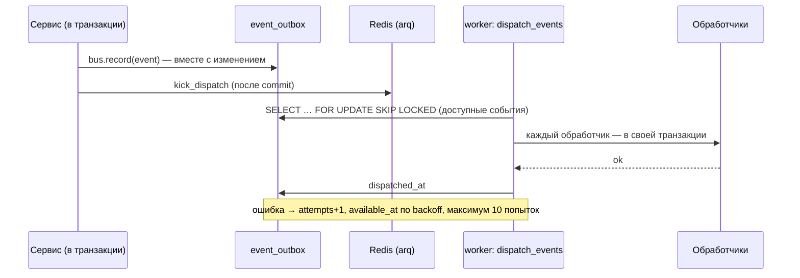
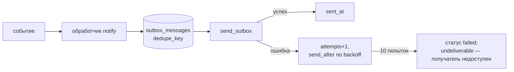

# События, воркер и уведомления

## Доменные события и outbox

События (`events/types.py`) — контракт между модулями: pydantic-модели с именем и скалярным payload (только идентификаторы,
обработчик читает актуальное состояние из БД).

| Группа | События |
|---|---|
| Подписка | `subscription.activated`, `.renewed`, `.auto_renew_cancelled`, `.expired` |
| Трафик | `traffic.warning` (80%), `traffic.exhausted`, `traffic.reset` |
| Клиент и устройства | `client.blocked`, `client.unblocked`, `device.issued`, `device.revoked` |
| Платежи | `payment.received`, `payment.refunded`, `payment.needs_review` |
| Рефералы | `referral.rewarded`, `referral.tier_reached` |
| Инфраструктура | `node.status_changed`, `webhook.dead_lettered`, `webhook.rejected` |

- Событие появляется **тогда и только тогда**, когда зафиксировано изменение, которое его породило.
- Доставка **at-least-once**: обработчики идемпотентны и не делают `commit`/`rollback`.
- Параллельные воркеры безопасны (`SKIP LOCKED`). Застрявшие события замечает `alert_stuck_events` и сообщает админу.
- Регистрация обработчиков — явная, при старте воркера (`flows/handlers.register`, `flows/notify.register`), а не при импорте.

### Обработчики

| Событие | Что делает обработчик |
|---|---|
| подписка активирована/продлена/истекла, блокировка/разблокировка, устройство выпущено/отозвано, трафик исчерпан/сброшен | `sync_node_access`: пересчёт `allowed.list` на всех нодах |
| `payment.received` | `reward_referrer`: награда за первую оплату друга |
| подписка активирована/продлена | `apply_pending_rewards`: применить отложенные награды |
| почти все события | `flows/notify.py`: положить уведомление клиенту и/или алерт админу в очередь (см. ниже) |

## Воркер (`apps/worker.py`)

Процесс arq: функции очереди и cron. Новая cron-задача обязательно регистрируется в `WorkerSettings.cron_jobs` и в тесте
`test_worker.py::test_cron_registry`.

| Задача | Расписание | Что делает |
|---|---|---|
| `dispatch_events` | каждые 5 с (+ «пинок» после commit) | доставка событий обработчикам |
| `send_outbox` | каждые 5 с | отправка сообщений в Telegram |
| `check_nodes` | каждую минуту | опрос здоровья ноды, событие при смене статуса |
| `expire_subscriptions` | каждую минуту | подписки с истёкшим сроком → `expired` |
| `apply_revocations` | каждые 30 с | отозванные ключи → CRL на ноде |
| `sweep_webhooks` | каждую минуту | вернуть в очередь зависшие вебхуки |
| `collect_traffic` | каждые 5 минут | опрос сессий, дельты, расход по подпискам, квоты |
| `reconcile_nodes` | каждые 5 минут | сверка ноды с БД |
| `detect_abuse` | каждые 15 минут | алерты о подозрении на злоупотребление |
| `expiry_reminders` | раз в час | напоминания об окончании подписки |
| `check_server_cert` | каждые 6 часов | сертификат сервера продлён → обновить копию на ноде |
| `refresh_crl` | раз в сутки, 03:00 | продлить срок CRL |
| `purge_event_outbox`, `purge_traffic` | раз в сутки, 04:00 | чистка доставленных событий и старых замеров |
| `alert_stuck_events` | раз в сутки, 09:00 | сообщить о застрявших событиях |
| `process_webhook` | по требованию | обработать вебхук (повторы: 1, 2, 4, 8, 16, 32 мин, дальше час) |

Недоступность ноды не считается сбоем задач: они фиксируют это (лог, отчёт сверки, алерт при смене статуса) и повторяют на
следующем цикле.

## Уведомления

- Получатели: клиент (`recipient_type=client`) или админы (чаты из настройки `admin_chat_ids`).
- `dedupe_key` защищает от дублей при повторной доставке события (например, один алерт о бэкапе в сутки).
- Шаблоны `ru`/`en` (`notifications/templates`) отрисовываются при отправке на языке клиента. Список: оплата принята, ключ
  выдан/отозван, подписка скоро закончится/закончилась, трафик 80%/исчерпан, нода недоступна/восстановлена, вебхук мёртвый или
  с неверной подписью, ошибка бэкапа, подозрение на злоупотребление, события рефералов и т. д.
- Бот ничего не рассылает сам; он отвечает на команды (`/start`, `/whoami`) и открывает Mini App.

## Что делать, если…

| Симптом | Куда смотреть |
|---|---|
| оплата прошла, подписки нет | админка → «Платежи → Вебхуки» (статус `failed`/`dead`), «Переобработать» |
| ключ выдан, подключиться нельзя | «Нода → Сверить»; `allowed.list`; `occtl show users`; журнал `ocm logs ocserv` |
| уведомления не приходят | `admin_chat_ids` (`ocm admin-chat`), `ocm logs worker`, доступ сервера к Telegram |
| события копятся | `event_outbox` (`attempts`, `last_error`), алерт «застрявшие события» |
