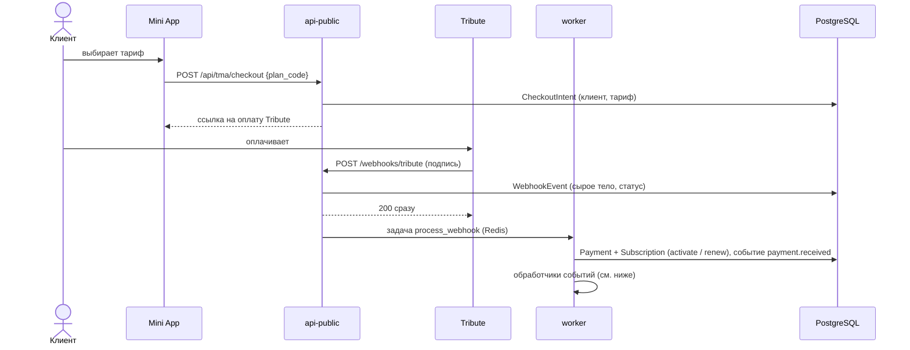
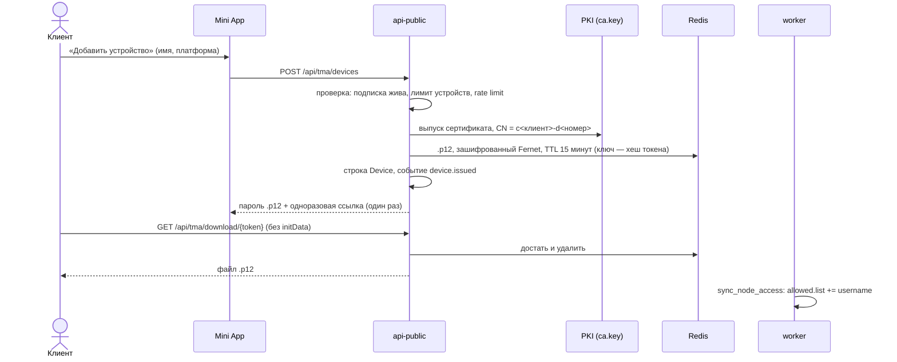
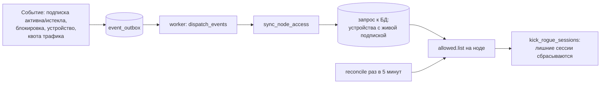
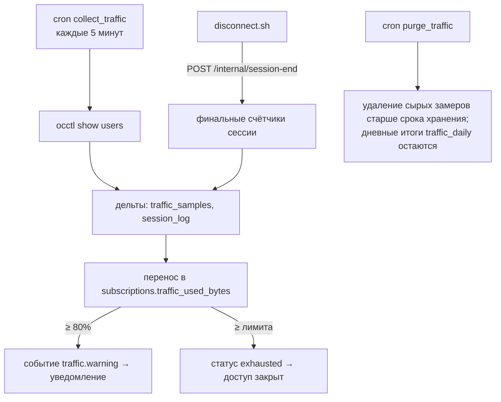
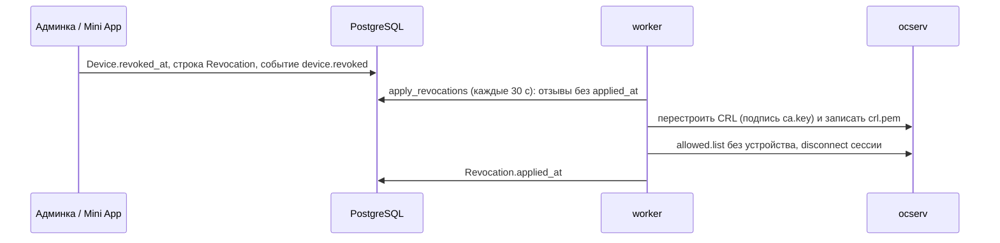
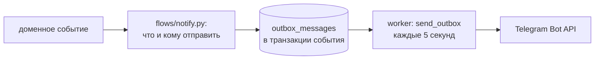

# Потоки данных

Сквозные сценарии: что и в каком порядке происходит между компонентами. Имена модулей даны для навигации по коду.

## 1. Покупка подписки



- Вебхук **только записывается**, бизнес-логика идёт в воркере (`flows/purchase.py`). Ошибка обработки не превращается в
  шторм повторов от провайдера. Повторная доставка того же события игнорируется (уникальный id).
- Не принятые платежи (неверная подпись, заблокированный клиент, неизвестный тариф) попадают в админку («Платежи → Вебхуки»)
  и в алерт админу; их можно переобработать вручную.

## 2. Выдача ключа устройству



- Файл `.p12` **не пишется на диск**; ссылка и пароль живут только в памяти экрана Mini App (`secretVault.ts`).
- Отозванные номера устройств не переиспользуются.

## 3. Подключение к VPN

```mermaid
sequenceDiagram
    actor V as VPN-клиент
    participant N as nginx
    participant O as ocserv
    participant H as connect.sh
    V->>N: TLS ClientHello (SNI = домен VPN)
    N->>O: прозрачно, с PROXY-заголовком (реальный IP)
    V->>O: клиентский сертификат
    O->>O: цепочка до нашего CA, CRL
    O->>H: connect-script (USERNAME = CN)
    H->>H: grep username в allowed.list
    H-->>O: 0 — пустить, иначе отказ
    O-->>V: туннель; маршруты и исключения no-route
```

Адрес для клиента содержит камуфляжный секрет (`https://vpn.example.com/?<secret>`): без него сервер выглядит как обычный сайт.

## 4. Как доступ попадает на ноду



Список пересчитывается **целиком** из БД, поэтому повторная доставка события безопасна. `reconcile` ловит потерянные события,
ручные правки на ноде и повреждённые файлы (список, CRL, маршруты).

## 5. Учёт трафика и квоты



Хук отключения добавляет «хвост» между последним опросом и концом сессии. Сброс/продление подписки возвращает доступ
(`traffic.reset`).

## 6. Истечение подписки и напоминания

- `expire_subscriptions` (каждую минуту): подписки с прошедшим `expires_at` → `expired`, событие `subscription.expired` →
  пересчёт `allowed.list`, сброс активных сессий, уведомление клиенту.
- `expiry_reminders` (раз в час): напоминания за N дней до конца (по умолчанию 3 и 1) кладутся в очередь уведомлений.

## 7. Отзыв ключа



CRL пересобирается пачкой, а не на каждый отзыв. Раз в сутки `refresh_crl` продлевает срок действия CRL
(просроченный CRL заставил бы ocserv отвергнуть все сертификаты).

## 8. Сверка ноды (reconcile)

Каждые 5 минут для каждой ноды: allowed.list → маршруты мимо VPN → CRL → лишние сессии. Всё найденное чинится и пишется в
аудит как «дрейф» (`reconcile.*`), последний отчёт виден в админке («Нода»). Ошибки ноды не прерывают задачу, а попадают
в отчёт.

## 9. Уведомления



Бот ничего не рассылает сам: сообщения кладутся в БД вместе с изменением, а отправляет воркер с повторами и экспоненциальной
задержкой. Рестарт бота или Telegram-сбой не теряют сообщения. Шаблоны: `notifications/templates/{ru,en}.json`.

Обработка вебхука в воркере повторяется с задержкой 1, 2, 4, 8, 16, 32 минуты, дальше раз в час (`webhook_retry_delay`); после исчерпания попыток событие помечается мёртвым и админ получает алерт.

## 10. Реферальная программа и промокоды

- Ссылка `t.me/<бот>?start=ref_<код>` → бот запоминает пригласившего при регистрации клиента.
- Первая оплата друга (`payment.received`) → награда: другу +3 дня, пригласившему +7 дней (потолок 10 наград за 30 суток).
  Уровни за 3, 5, 10 платящих друзей: +30 дней, +1 устройство, +100 ГБ трафика.
- Если у пригласившего нет живой подписки, награда ждёт (`pending`) и применяется при его следующем продлении или активации.
- Промокод (`POST /api/tma/promo/redeem`) даёт дни или трафик; ограничения: число использований, срок, один раз на клиента.

## 11. Маршруты мимо VPN

Админка → `PATCH /admin/settings {bypass_routes}` → запись в `settings` → `default-user.conf` в каталоге состояния ноды →
`docker exec ocm-render-conf` (собирает `ocserv.conf` из шаблона и строк `no-route`, проверяет `--test-config`) →
`occtl reload`. Действует на новые подключения. Подробнее: [deploy.md](deploy.md#нода-ocserv).
