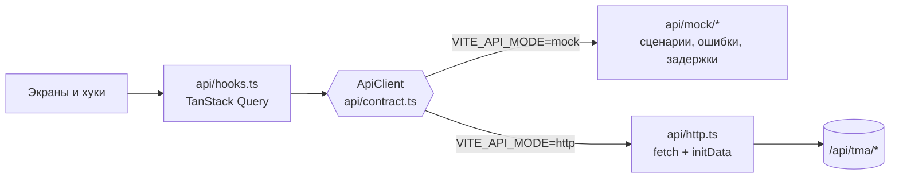
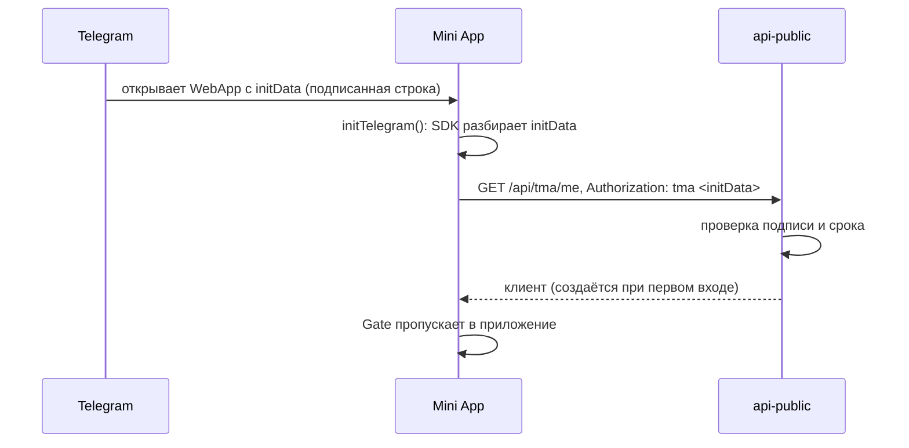
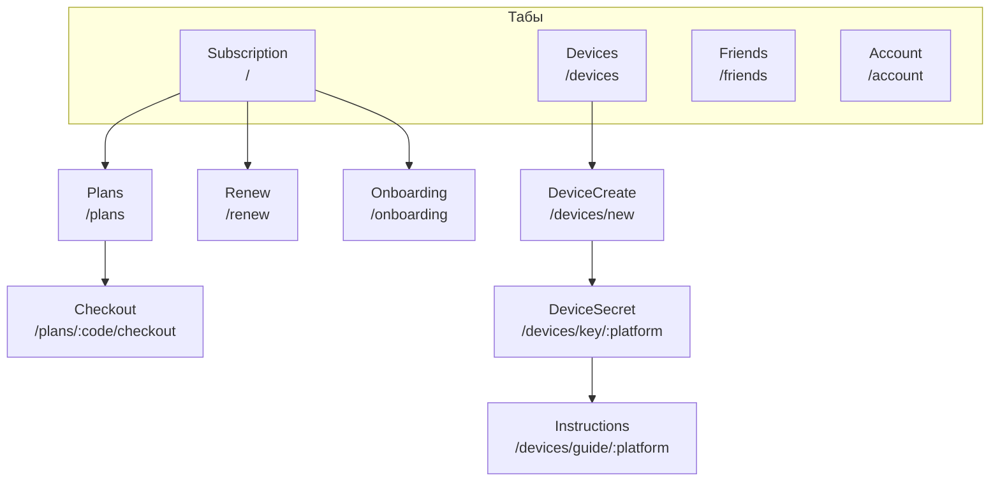

# Mini App: архитектура

Приложение внутри Telegram для клиента: подписка, оплата, ключи устройств, инструкции, друзья и промокоды. Запуск: [frontend/tma/README.md](../../frontend/tma/README.md).

## Стек

| Область | Что |
|---|---|
| Язык, UI | TypeScript 6, React 19, Tailwind CSS 4, свои компоненты в стиле Telegram (`ui/`) |
| Сборка | Vite 8; статику отдаёт Caddy (`deploy/web/Dockerfile`) |
| Telegram | `@telegram-apps/sdk` + `sdk-react`: initData, тема, кнопка «назад», haptics, ссылки |
| Данные | TanStack Query 5 поверх интерфейса `ApiClient` (две реализации) |
| Роутинг | React Router 7 |
| Прочее | `qrcode` для QR-кода ссылки на ключ |
| Тесты | Vitest + Testing Library + jsdom; общий набор контрактных тестов для обеих реализаций API |

## Главная идея: контракт API и две реализации

`ApiClient` — единственное, что экраны знают о бэкенде. Мок и HTTP проходят **один и тот же набор контрактных тестов**
(`test/contract.suite.ts`), поэтому интерфейс можно развивать без бэкенда, а переключение режима безопасно. Типы запросов и ответов
сверяются с OpenAPI бэкенда (`types.contract.test-d.ts`, `npm run api:check`).

### Мок и панель разработчика

`api/mock/` — in-memory «сервер»: клиент, подписка, устройства, рефералы. Сценарии (`scenarios.ts`): новый клиент, пробный
период, активная подписка, скоро истекает, мало трафика, трафик исчерпан, истекла, автопродление выключено, заблокирован, лимит
устройств. `DevPanel` (включается `VITE_DEV_PANEL=true`) переключает сценарии, задержку и сбои (сеть недоступна, 500, 429).
Сам мок и `mockEnv` (подмена среды Telegram) в прод не включаются.

## Запуск и авторизация

`Gate` (`app/Gate.tsx`) решает, что показать:

1. нет initData (приложение открыто не из Telegram) → заглушка «откройте в Telegram»;
2. идёт загрузка → скелетон;
3. ошибка (сеть, истёкшие данные) → экран ошибки с повтором;
4. иначе — приложение. Для заблокированного клиента `/me` возвращает `is_blocked`, экраны показывают причину.

Язык: из Telegram (`ru*` → русский, всё остальное → английский); ручного переключателя нет.

## Структура

| Каталог | Содержимое |
|---|---|
| `src/api` | `contract.ts` (интерфейс), `http.ts`, `mock/`, `hooks.ts` (запросы и мутации), `queryClient.ts`, `errors.ts`, `types.ts`, `generated.d.ts` |
| `src/app` | `App`, `router`, `routes.ts` (пути и таб-бар), `Layout`, `Header`, `TabBar`, `Gate`, `ErrorBoundary`, `ThemeProvider`, `DevPanel` |
| `src/screens` | экраны (ниже) |
| `src/telegram` | `init`, `auth` (initData, язык), `backButton`, `haptics`, `links`, `mockEnv` |
| `src/ui` | компоненты: `Button`, `Card`, `Cell`, `Sheet`, `Hero`, `ProgressBar`, `QrCode`, `StatusIcon`, `EmptyState`, `ErrorState` … |
| `src/i18n` | `ru.ts`, `en.ts`, плюрализация, `useTranslation` |
| `src/lib` | форматирование, вычисления по подписке, пробный период, буфер обмена |

## Экраны и навигация

Таб-бар виден на четырёх разделах; вложенные экраны занимают окно целиком (кнопка «назад» Telegram возвращает на уровень выше).

| Экран | Что делает |
|---|---|
| Subscription | статус, срок, трафик, устройства; пробный период; быстрые действия |
| Plans, Checkout | список тарифов и переход к оплате: `POST /checkout` → ссылка Tribute открывается через Telegram |
| Renew | продление |
| Devices, DeviceCreate | список ключей, отзыв, выпуск нового (имя + платформа) |
| DeviceSecret | пароль от `.p12`, одноразовая ссылка и QR показываются **один раз** |
| Instructions | пошаговая инструкция под платформу (`instructionSteps.ts`, `platforms.ts`) |
| Friends | реферальная ссылка, прогресс по уровням, история наград, ввод промокода |
| Account | профиль, поддержка, язык |
| Onboarding | первое знакомство |

### Секрет ключа

Пароль и ссылка на `.p12` живут только в памяти модуля `screens/secretVault.ts` на время открытого экрана. Не в URL, не в
`location.state`, не в кэше Query, не в storage: любое из этого пережило бы закрытие экрана или попало бы в логи и девтулзы.
Стирание — явное, при размонтировании экрана.

## Поведение данных

- Запросы: `staleTime` 30 с, до двух повторов только для повторяемых ошибок (`ApiError.retryable`), с растущей задержкой.
- Мутации **никогда не повторяются** автоматически: выпуск ключа не идемпотентен.
- Возврат в приложение (фокус окна) обновляет данные: так видно оплату, сделанную во внешнем окне.
- Ошибки API — единый класс `ApiError` с кодом из каталога бэкенда (`rate_limited`, `device_limit_reached` …); тексты — в i18n.

## Тема и оформление

`ThemeProvider` подхватывает тему Telegram (светлая/тёмная) и безопасные отступы; цвета заданы токенами в CSS. Шрифты лежат
в `public/fonts`. Размеры и интерактивные зоны рассчитаны на мобильный интерфейс.

## Тесты

Рядом с файлами (`*.test.tsx`). `contract.suite.ts` прогоняется для мока и для HTTP-клиента (с подменой `fetch`); экраны тестируются
через `renderWithProviders` на моке в нужном сценарии.
